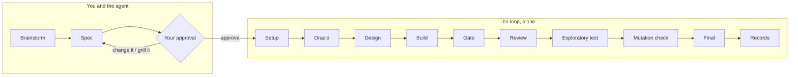

# hstack

**A Claude Code plugin: a build loop that does not take the agent's word for "done".**

You ask for a feature. hstack talks it through with you, writes a spec, and waits for your approval. Then it builds the feature on its own, and checks the result with agents that did not write the code: one writes the acceptance tests before any code exists, one reviews, one tries the product from outside, one plants bugs to see whether the tests notice.

It works on any stack: the loop finds out by itself how your project is tested and run.

## Contents

- [Why](#why)
- [Quick start](#quick-start)
- [How it works](#how-it-works)
- [Skills](#skills)
- [Requirements](#requirements)
- [Status](#status)
- [Development](#development)
- [Known limits](#known-limits)
- [Help and contributing](#help-and-contributing)
- [License](#license)

## Why

An agent that builds a feature and tests it alone grades its own work. hstack splits that work up:

- **You decide what is built.** Nothing is built before you approve the spec, and after that the loop asks you nothing more.
- **The tests come from someone else.** An independent oracle writes the acceptance tests from the spec alone, before the code.
- **A gate against weakened tests.** A gate lists every acceptance test and every earlier test that was changed or removed, and the builder must put each back or account for it.
- **Three more pairs of eyes, each in its own context.** A reviewer, an exploratory tester and a mutation check.
- **The project remembers.** Every run leaves the spec, the builder's decisions, each acceptance step with the tests that check it, and a log entry.

## Quick start

You need Claude Code, git and [Bun](https://bun.sh) 1.4.4 or later on macOS or Linux ([details](#requirements)).

```
/plugin marketplace add emulatalk1/hstack
/plugin install hstack@hstack
```

You can also add a local clone: `/plugin marketplace add /path/to/hstack`.

Then, in your project, ask for what you want in plain words:

```
add a CSV export to the invoices page
```

1. The agent answers with what it understood and what it found in your code. You talk until it is clear.
2. It writes a spec and gives you its path. You approve it, say what to change, or have it grilled.
3. After your approval the loop runs to the end without you.
4. Its last reply says what was built, what the tests show, and what needs your ruling.

## How it works



**Before your approval**

- **Brainstorm.** The agent says what it understood and what it found; you talk until it is clear. It can show mock-ups in a browser tab.
- **Spec.** What was agreed, the feature's behaviours in sentences you can check, and every place where the request goes against the project's record.
- **Your choice.** Approve it, say what to change, or have it grilled: rounds of numbered questions, each with a recommended answer.

**After your approval**

- **Setup.** The loop finds how to test and run the project, and proves each test command with a throwaway failing test.
- **Oracle.** An independent agent writes the acceptance tests from the spec, before any code.
- **Design.** The builder writes down which files it creates or changes and what each is responsible for.
- **Build and gate.** The feature is built test-first; a gate checks that no test was weakened.
- **Review, exploratory test, mutation check.** Each runs in its own context.
- **Final.** The tests, the build and the type-check run once more on the last commit.
- **Records.** The spec, the builder's decisions, each acceptance step with the tests that check it, and a log entry are kept in the project (`docs/specs/` and `progress/`).

The loop's playbook, with every rule of each step, is [`skills/build/SKILL.md`](skills/build/SKILL.md).

## Skills

| Skill | Use it |
|---|---|
| `build` | Any request to build, change or fix code. Asks only before the approval: a brainstorm, the spec, a grill if you want one; then runs to the end. Loop agents: `oracle`, `reviewer`, `explorer`, `mutator`. |
| `brainstorm` | Step 1 of `build`: the talk before the spec, which ends by writing it. Typed by you with a request, it is the start of a build. |
| `grill` | Step 1 of `build`: a relentless interview on the spec that waits for your approval, when you ask for one. |
| `build-implement` | Step 4 of `build`: the entry points, the edges and the design, the feature written test-first, the checks. Invoked by the loop, not by you. |
| `hstack-feedback` | When you find a problem with hstack and want it written up as an issue, or want the open ones listed. User-invoked only; posting needs `gh`. |
| `hstack-init` | Once per project, and again after the project folder is copied or moved. |
| `hstack-safety` | Before any Docker command, port stop, database drop or folder wipe. |

`hstack-init` and `hstack-safety` are older tools for two fixed stacks; they are user-invoked only.

## Requirements

- Claude Code.
- git.
- [Bun](https://bun.sh) 1.4.4 or later, on the `PATH` of the machine where Claude Code runs, whatever the project's own stack is. The plugin itself has nothing to install.
- macOS or Linux.

The three hooks of `hstack:build` are `bun` commands. On a machine where `bun` is not on the `PATH` of the Claude Code process, all of them fail (`bun: command not found`) and the stop gate is off: Claude Code shows "stop hook problem" at each stop, and the agent goes on without the gate.

## Status

**Status: v0.4.6.** `hstack:build` is a build loop for any stack. It starts with a **brainstorm** that ends in a **spec**, which you approve, change or have **grilled**. Nothing is built before you approve it; after that the loop runs to the end on its own. Before any product code the builder writes a section `## Design` into its decisions, by the design rules of `skills/build-implement/design-rules.md`. Three hooks keep the loop going. From the approval on the builder says in a line what it is about to do before each step, and in a line what the step found after it. The last reply is written for a reader who did not see the run, as `skills/build/last-reply.md` says, and the log entry first for the agent of a later session: a decision's number and a test's name come with the path of the file that holds them.

## Development

```
bun install
bun test ./tests
bun x tsc --noEmit
```

- The whole suite takes about 11 minutes; `bun test tests/hstack.test.ts` runs only the tests of the build loop's script, in about a minute and a half.
- Every script and every test is TypeScript, run with Bun. Add no new `.sh` or `.mjs` file; the `.mjs` files that exist stay as they are until they are converted or retired.
- The loop's run state lives in `~/.hstack/<checksum of the git dir>/`, never in the work tree.
- Designs are in [`plugin-dev/`](plugin-dev/), and the spec of each later change in [`docs/specs/`](docs/specs/).

| Path | What it holds |
|---|---|
| `.claude-plugin/` | plugin and marketplace manifests |
| `scripts/` | the command-line scripts; `scripts/lib/` holds one module per job; `mockup-frame.html` is the frame of the mock-up server's pages |
| `skills/` | `build`, `brainstorm`, `grill`, `build-implement`, `hstack-feedback`, `hstack-init`, `hstack-safety` |
| `agents/` | the four agents of the build loop: `oracle`, `reviewer`, `explorer`, `mutator` |
| `hooks/` | the SessionStart, UserPromptSubmit and Stop hooks of the build loop |
| `plugin-dev/` | the designs of the build loop |
| `tests/` | tests, and their fixtures in `tests/fixtures/` |
| `bench/` | the closed benchmark's code; its report is `progress/final-report.md` |
| `fixtures/electron/` | the stack B probe app |
| `docs/` | design, plans, decisions, specs and stack adapters (an OKF v0.2 bundle) |
| `progress/` | the working log: review cost per task, the build ledger; and the project's records (`feature_list.json`, `test-coverage.md`, `progress.md`) |

## Known limits

- The `docker` check of `hstack-safety` refuses any Compose input it does not read, so it may refuse a harmless setup. That is on purpose; a wrong "allowed" costs more than a wrong "refused".
- `hstack-init` warns about every `localhost:<port>` in `src/` and `tests/`, including URLs inside unit tests.
- The Windows branch of the mock-up server (`scripts/mockup.ts`) has not been run on Windows; a test checks the decision only.

## Help and contributing

Questions and bug reports go to the [issues](https://github.com/emulatalk1/hstack/issues). Inside Claude Code, `/hstack:hstack-feedback <what you found>` writes the issue for you, shows you its exact text, and posts only on your yes.

Pull requests are not accepted. Maintainer: [@emulatalk1](https://github.com/emulatalk1).

## License

No licence has been granted yet: all rights reserved.
